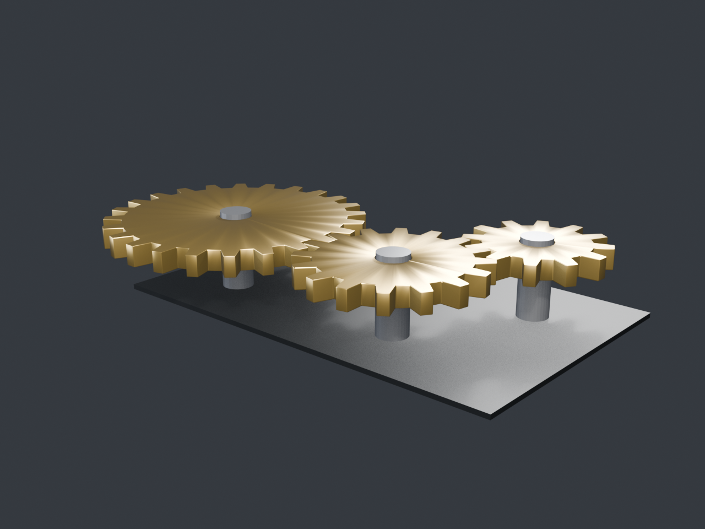
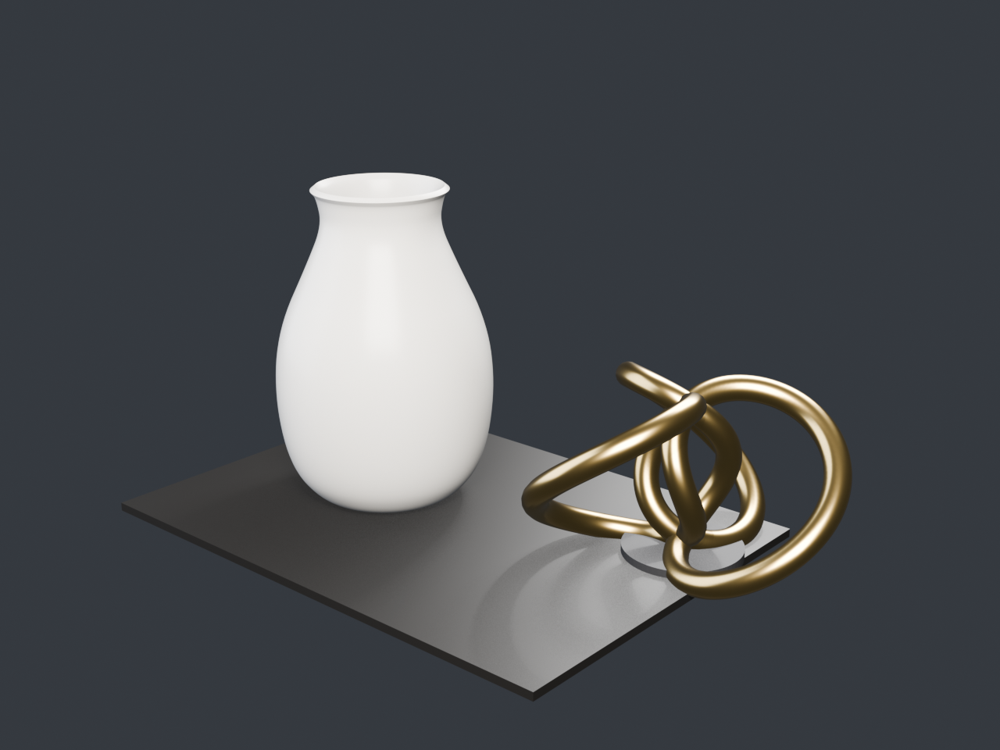

# Blender MCP Server

> **Sponsored by 95算力** — computing power for this project is provided by 95算力.

English | [中文](README.md)

A dependency-free **MCP (Model Context Protocol)** server that drives a local
**Blender 5.2 LTS** for AI-assisted modeling, rendering and export.

- Runs on Blender's bundled Python 3.13 — no pip installs, no external packages.
- stdio transport (JSON-RPC 2.0), supports protocol versions `2024-11-05`,
  `2025-03-26` and `2025-06-18`.
- Returns real MCP **image blocks**, so any MCP client can *see* the render.





## Architecture

```
MCP client (Claude Desktop / Cline / DSH / ...)
   │ stdio JSON-RPC 2.0
   ▼
server.py   tool layer: validation, image blocks, timeouts, auto-restart
   │ line protocol, responses prefixed with @@MCP@@
   ▼
bridge.py   runs inside blender --background, talks to bpy directly
   ▼
genlib.py   parametric geometry
```

`server.py` spawns and supervises the Blender child process; Blender's stderr
goes to `output/blender_stderr.log` and never pollutes the MCP stdout channel.

## Quick start

```bash
cd blender-mcp
"D:/Blender/5.2/python/bin/python.exe" server.py
```

Then write a single line to stdin:

```json
{"jsonrpc":"2.0","id":1,"method":"initialize","params":{"protocolVersion":"2025-06-18","capabilities":{},"clientInfo":{"name":"probe","version":"0"}}}
```

Demos:

```bash
"D:/Blender/5.2/python/bin/python.exe" tests/test_bridge.py   # bridge only
"D:/Blender/5.2/python/bin/python.exe" tests/test_mcp.py      # full MCP protocol
"D:/Blender/5.2/python/bin/python.exe" examples/demo_gears.py # gear train
"D:/Blender/5.2/python/bin/python.exe" examples/demo_still.py # still life
```

## Client configuration

```json
{
  "mcpServers": {
    "blender": {
      "command": "D:\\Blender\\5.2\\python\\bin\\python.exe",
      "args": ["D:\\Dump\\blender-mcp\\server.py"]
    }
  }
}
```

Works with Claude Desktop (`claude_desktop_config.json`), Cline / Roo Code,
DeepSeek Harness and any other stdio MCP host.

## Tools (14)

| Group | Tools |
| --- | --- |
| Scene | `blender_status`, `scene_reset`, `list_objects` |
| Modeling | `add_primitive`, `transform_object`, `delete_objects`, `set_material`, `boolean_operation`, `add_modifier`, `create_preset_model` |
| Output | `render_preview` (returns an image block), `export_model`, `save_blend` |
| Escape hatch | `run_blender_python` |

Presets: `gear`, `hex_bolt`, `vase`, `torus_knot`, `lowpoly_tree`.

```python
gear(teeth=18, pitch_radius=1.0, thickness=0.24, tooth_height=0.18,
     bore_radius=0.20, tip_ratio=0.30, root_ratio=0.58)
vase(segments=64, height=2.0, thickness=0.05, profile=None)
torus_knot(p=2, q=3, major_radius=1.0, minor_radius=0.18, segments=240)
```

Gears are built with a coaxial annular topology instead of booleans, so the bore
stays clean and same-module gears mesh exactly (center distance = r1 + r2).

## Known limitations

- `--background` has no UI thread: modal operators are unavailable, everything
  goes through the bpy data API.
- Only `BLENDER_EEVEE` is enumerated on this machine; `"engine": "CYCLES"` is
  forced through (plugin present, not tuned).
- `run_blender_python` is unsandboxed — use it on trusted local setups only.
- Rendering is synchronous; high resolution + high samples can consume the whole
  tool-call time budget (600 s default).

## Sponsor

**由 95算力 赞助** — this project is sponsored by 95算力.

## License

[MIT](LICENSE)
