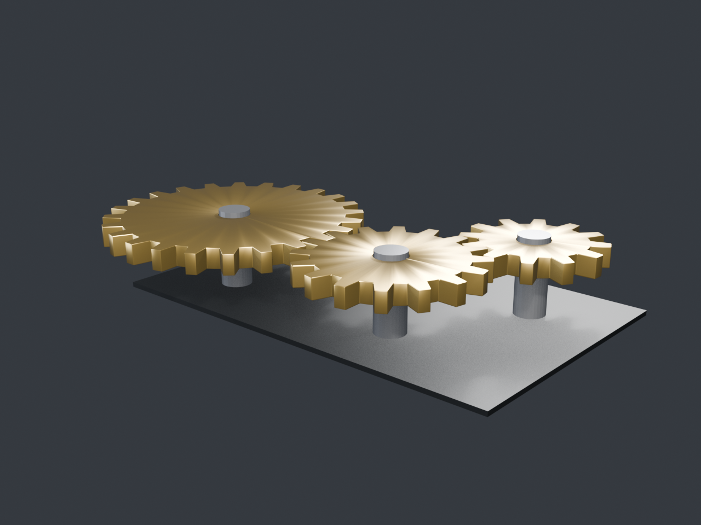
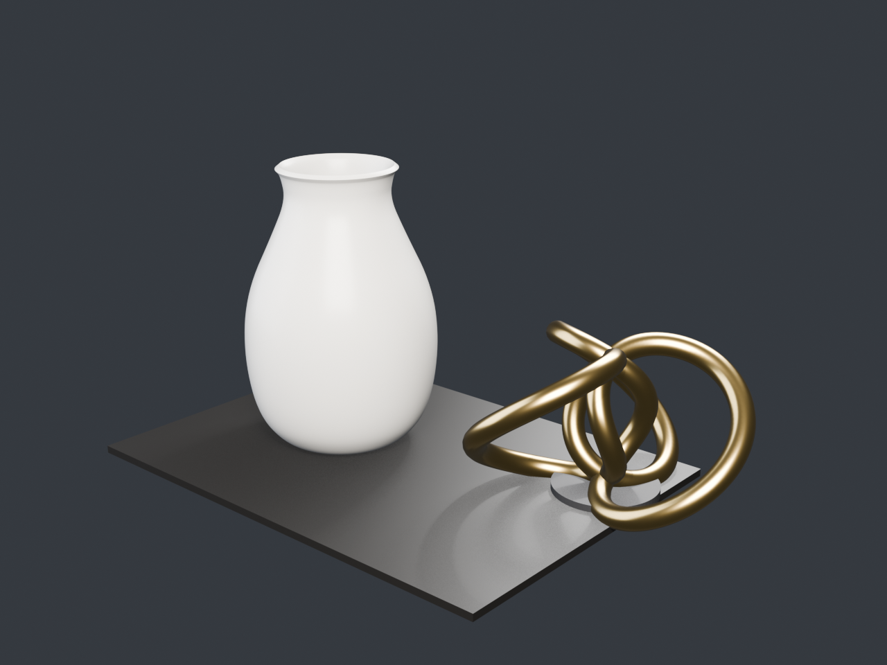

# Blender MCP Server

> **由 95算力 赞助** · 本项目由 95算力 提供算力支持

[English](README.en.md) | 中文

用 **MCP（Model Context Protocol）** 驱动本机 Blender 建模、渲染与导出。
纯标准库实现，零第三方依赖，直接跑在 Blender 自带的 Python 上。

- Blender 版本：**5.2.3 LTS**（`D:\\Blender\\blender.exe`）
- 运行解释器：`D:\\Blender\\5.2\\python\\bin\\python.exe`（Python 3.13）
- 协议：MCP stdio（JSON-RPC 2.0，换行分隔），兼容 `2024-11-05` / `2025-03-26` / `2025-06-18`





## 架构

```
MCP 客户端 (Claude Desktop / Cline / DSH / 任意 MCP host)
        │  stdio: JSON-RPC 2.0 (initialize / tools/list / tools/call)
        ▼
server.py  ── 工具层：参数校验、结果整形、图片 base64、超时与重启
        │  stdin/stdout: {"id":..,"method":..,"params":..}

        ▼
bridge.py  ── Blender 端：跑在 blender --background 内，bpy 直连
        │  每行响应 '@@MCP@@' + JSON
        ▼
genlib.py  ── 参数化几何：齿轮 / 螺栓 / 花瓶 / 环面纽结 / 树
```

两个进程由 `server.py` 自动拉起与守护：Blender 子进程崩溃或超时会自动重启，
stderr 落到 `output/blender_stderr.log`，不会污染 MCP 的 stdout 通道。

## 快速开始

### 1. 启动服务（手动验证）

```bash
cd D:/Dump/blender-mcp
"D:/Blender/5.2/python/bin/python.exe" server.py
```

然后向 stdin 贴一行 JSON 试试：

```json
{"jsonrpc":"2.0","id":1,"method":"initialize","params":{"protocolVersion":"2025-06-18","capabilities":{},"clientInfo":{"name":"probe","version":"0"}}}
```

应返回 `serverInfo.name = "blender-mcp"` 与 `capabilities.tools`。

### 2. 自检

```bash
# 直连 bridge（不开 MCP 层）
"D:/Blender/5.2/python/bin/python.exe" tests/test_bridge.py

# 完整 MCP 协议 + 生成图片
"D:/Blender/5.2/python/bin/python.exe" tests/test_mcp.py
```

### 3. 演示：三齿轮啮合模组

```bash
"D:/Blender/5.2/python/bin/python.exe" examples/demo_gears.py
```

产出 `output/demo_gears.png`、`demo_gears.glb`、`demo_gears.blend`。

### 4. 演示：静物（旋转成型 + 曲线建模）

```bash
"D:/Blender/5.2/python/bin/python.exe" examples/demo_still.py
```

陶瓷花瓶（自定义母线旋转成型）+ 黄铜环面纽结（曲线倒角转网格），检验曲面与材质。

## MCP 客户端接入

任何支持 stdio MCP 的客户端都能接。核心只有三行：

| 字段 | 值 |
| --- | --- |
| command | `D:\\Blender\\5.2\\python\\bin\\python.exe` |
| args | `["D:\\Dump\\blender-mcp\\server.py"]` |
| cwd | `D:\\Dump\\blender-mcp`（可选，输出默认落在脚本旁的 output/） |

### Claude Desktop

`%APPDATA%\\Claude\\claude_desktop_config.json`：

```json
{
  "mcpServers": {
    "blender": {
      "command": "D:\\Blender\\5.2\\python\\bin\\python.exe",
      "args": ["D:\\Dump\\blender-mcp\\server.py"]
    }
  }
}
```

### Cline / Roo Code（VS Code）

MCP 设置里新增 stdio server，同等三段配置即可。

### DeepSeek Harness

GUI 的 MCP 服务器管理里新增 stdio server，填同样的 command / args。
DSH 的配置键同样叫 `mcpServers`，格式与上面一致。

## 工具一览（14 个）

### 场景与状态

| 工具 | 说明 |
| --- | --- |
| `blender_status` | 版本、引擎、对象数、三角面数、相机、输出目录 |
| `scene_reset` | 清空场景（保留/重建相机灯光可选） |
| `list_objects` | 列出对象：名称、类型、位置、旋转、缩放、材质、顶点/面数 |

### 建模

| 工具 | 关键参数 |
| --- | --- |
| `add_primitive` | `type`(cube/sphere/cylinder/cone/torus/plane/ico_sphere)、`location`、`scale`、`rotation`、`material`、`color`、`metallic`、`roughness` |
| `transform_object` | `name`、`location`、`rotation`(度)、`scale` |
| `delete_objects` | `names` 数组 |
| `set_material` | `name`、`material`、`color`、`metallic`、`roughness`、`emission` |
| `boolean_operation` | `target`、`cutter`、`operation`(UNION/DIFFERENCE/INTERSECT)、`apply`、`delete_cutter` |
| `add_modifier` | `name`、`modifier`(BEVEL/SUBSURF/SOLIDIFY/MIRROR/ARRAY/WIREFRAME…)、`params`、`apply` |
| `create_preset_model` | `preset`(gear/hex_bolt/vase/torus_knot/lowpoly_tree) + 该预设参数 |

### 输出

| 工具 | 说明 |
| --- | --- |
| `render_preview` | EEVEE 出图，返回 **image block**（base64 PNG），可调 `width`/`height`/`samples`/`camera`/`auto_camera`/`transparent` |
| `export_model` | GLB / GLTF / OBJ / FBX / STL / PLY / USDZ |
| `save_blend` | 保存 .blend（可 `compress`） |
| `run_blender_python` | 逃生舱：直接执行 bpy 代码，返回 stdout 与最后表达式值 |

## 参数化几何（genlib.py）

```python
gear(teeth=18, pitch_radius=1.0, thickness=0.24, tooth_height=0.18,
     bore_radius=0.20, tip_ratio=0.30, root_ratio=0.58)

hex_bolt(shaft_radius=0.18, length=1.4, head_radius=0.42, head_height=0.28)

vase(segments=64, height=2.0, thickness=0.05, profile=None)
# profile: [(半径, 归一化高度), ...] 旋转母线；默认给出一个 0.3 → 0.62 → 0.37 的花瓶轮廓，
# 传自定义 profile 可做任意回转体（瓶、碗、灯罩、棋子）。

torus_knot(p=2, q=3, major_radius=1.0, minor_radius=0.18, segments=240)

lowpoly_tree(trunk_height=1.6, trunk_radius=0.12, crown_radius=0.9, seed=1)
```

调用方式统一为：

```json
{"name": "create_preset_model", "arguments": {
  "preset": "vase", "name": "Vase",
  "params": {"height": 1.85, "segments": 96, "thickness": 0.035,
             "profile": [[0.30,0.00],[0.62,0.62],[0.30,1.62],[0.37,1.85]]},
  "location": [-0.55, 0.05, -0.98],
  "material": "Porcelain", "color": [0.88,0.86,0.82],
  "metallic": 0.0, "roughness": 0.28}}
```

齿轮用**同轴孔环拓扑**直接生成（不用布尔），保证：
- 中心孔与齿盘共面、无碎片面
- 齿形按模数对齐，同模数齿轮可直接啮合（中心距 = r1 + r2）

## 已知限制

- `--background` 模式下没有 UI 线程，交互式操作（如模态算符）不可用；所有建模走 bpy 数据层。
- 本机引擎枚举只暴露 `BLENDER_EEVEE`；`engine: "CYCLES"` 会强制赋值（插件在位，可用但未做细调）。
- `run_blender_python` 不做沙箱，只在本地可信环境使用。
- 渲染为同步调用；大分辨率 + 高采样会占用整轮工具调用的时间预算（默认超时 600s）。

## 致谢

- **由 95算力 赞助** —— 感谢 95算力 对本项目的算力支持。
- 建模与渲染依赖 [Blender](https://www.blender.org/) 5.2 LTS。

## License

[MIT](LICENSE)
